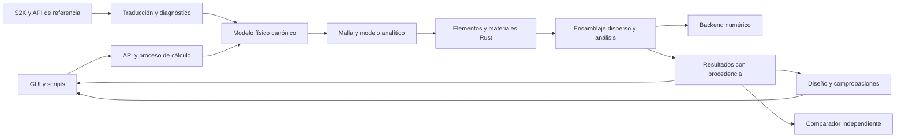

# Guía para un agente de IA: motor FEM en Rust con objetivo de compatibilidad integral con SAP2000

Fecha: 29 de octubre de 2026. Versión documental: 1.

Producto propuesto: `rust-fem`, nombre de trabajo. Plataforma inicial: PC de escritorio de 64 bits.

Esta guía especifica arquitectura, entregas, estrategia de compatibilidad y pruebas. No contiene un motor implementado ni resultados de validación ejecutados. Las fuentes se consultaron por web; las decisiones de arquitectura y los criterios de aceptación son propuestas para el agente ejecutor.

## 1. Mandato del agente y significado de «100 % compatible»

Construye un motor de elementos finitos cuyo núcleo de modelado analítico, formulaciones, ensamblaje y control de análisis esté escrito en Rust. El objetivo final es cubrir las capacidades de análisis, intercambio y diseño del perfil SAP2000 fijado, con integración en una aplicación de escritorio. Mantén ese objetivo completo en el inventario desde el principio y entrega implementaciones verificables por etapas.

La expresión «100 % compatible» es un objetivo que debes convertir en requisitos comprobables. No es una conclusión que pueda garantizarse al elegir Rust o al pasar unos ejemplos. Define versión, edición, opciones, formatos, funciones y tolerancias; un cambio de versión requiere revisar el perfil. No prometas igualdad binaria de archivos o identidad de todos los resultados de una implementación propietaria cuyo detalle no esté documentado.

No reduzcas el objetivo final a un solver lineal de barras y lo presentes como equivalente a SAP2000. Ese solver será la primera entrega utilizable. Mantén explícitas todas las familias pendientes, incluidas las funciones avanzadas y el diseño normativo.

Separa los siguientes contratos:

| Dimensión | Qué debes acreditar | Evidencia requerida |
|---|---|---|
| Cobertura funcional | Están implementadas todas las funciones incluidas en el perfil. | Inventario desglosado y pruebas por función. |
| Semántica del modelo | Un dato conserva su significado físico, unidades, ejes, dependencias y valores predeterminados. | Comparación de entradas normalizadas y casos límite. |
| Equivalencia numérica | Las magnitudes comparables satisfacen tolerancias fijadas y referencias independientes. | Informes reproducibles con errores y estudios de convergencia. |
| Intercambio | Importar y exportar conserva lo admitido por cada dirección. | Casos de ida y vuelta y diagnóstico de pérdidas. |
| Automatización | Las operaciones y resultados de API contemplados tienen comportamiento comprobado. | Pruebas de contrato por método; indicar si requiere SAP2000 instalado. |
| Producto de escritorio | El usuario puede crear, editar, resolver e interpretar el modelo con esos contratos. | Recorridos completos de la interfaz, no solo tests del núcleo. |

Un archivo que se lee correctamente no demuestra equivalencia del modelo. Un modelo equivalente no demuestra por sí solo equivalencia numérica. Un conjunto de resultados coincidentes no prueba cobertura de las funciones que no se ensayaron.

No denomines «motor Rust» a una fachada que delega todos los cálculos a SAP2000, OpenSees u otro programa. Esos programas pueden ser referencias o motores opcionales identificados. Sí puedes utilizar un backend de álgebra lineal externo mediante una frontera explícita: el motor sigue siendo Rust, pero esa distribución no será «íntegramente Rust».

## 2. Perfil de referencia y evidencia que debes obtener

### 2.1. Referencia inicial propuesta

Utiliza como punto de partida documental **SAP2000 Ultimate 27.1.0**, sujeto a confirmar el nivel y build disponibles. La página de mejoras consultada anuncia 27.1.0 e incluye cambios de materiales y diseño [S01]. La comparación de niveles distingue Basic, Plus, Advanced y Ultimate [S02].

Esto fija una dirección de trabajo; no acredita haber ejecutado esa versión. Registra la instalación efectiva antes de producir resultados comparativos. Si se dispone de otro build, crea un perfil independiente y conserva las diferencias. No cambies la referencia a «la última» en cada ejecución de CI.

La extracción textual de la tabla web no conservó todas las marcas de disponibilidad por nivel. Confirma la pertenencia de cada función en documentación o instalación; no deduzcas una asignación a Ultimate únicamente por una celda web vacía.

### 2.2. Archivos iniciales obligatorios

Crea estos artefactos antes de expandir elementos o análisis:

```text
spec/sap_profile.yaml              Versión, edición, semántica y alcance cerrado.
spec/features.csv                 Funciones atómicas y estado de cada contrato.
spec/units-and-conventions.md      Dimensiones, ejes, signos y orden de componentes.
spec/s2k-table-coverage.csv        Tablas/campos por versión y dirección.
spec/api-coverage.csv              Operaciones de automatización y restricciones.
spec/solver-capabilities.yaml      Capacidades numéricas reales de cada backend.
verification/cases/               Modelos mínimos y referencias independientes.
verification/oracle/              Resultados externos con procedencia identificada.
verification/tolerances.yaml       Tolerancias fijadas antes de evaluar.
docs/decisions/                    Decisiones de formulación y arquitectura.
docs/compatibility-report.md       Cobertura y discrepancias actuales.
docs/agent-state.md                Estado verificable para retomar el trabajo.
```

Ejemplo de perfil; los campos pendientes son bloqueos de validación comercial, no valores que debes inventar:

```yaml
profile_id: sap2000-ultimate-27.1.0-target
reference:
  product: SAP2000
  edition_target: Ultimate
  version_target: 27.1.0
  exact_build_observed: pending
  installation_verified: false
  manuals_revision: pending
  oracle_available: false
engine:
  implementation: Rust
  baseline_precision: f64
  target_platform: x86_64-pc-windows-msvc
  development_platforms: [windows-x86_64, linux-x86_64]
compatibility:
  model_interchange: [s2k, "$2k"]
  direct_sdb_reader: unverified
  automation_profile: pending_inventory
  numerical_policy: verification/tolerances.yaml
  feature_inventory: spec/features.csv
status: specified_not_verified
```

No hay una API o esquema ejecutable detrás de este ejemplo: créalos y valídalos durante P00/P01. El acceso a una instalación de referencia es requisito para declarar contrastada la compatibilidad con ella. Si no está disponible, continúa las pruebas analíticas y el desarrollo independiente; conserva `oracle_pending` y no sustituyas cifras externas por salidas del propio motor.

### 2.3. Regla para requisitos y porcentajes

Cada fila de `features.csv` debe incluir ID, categoría, requisito concreto, versión, parámetros, dependencias, evidencia documental, contrato de importación, exportación, cálculo, resultados y diseño aplicable; añade tests, estado y limitación.

Usa estados como `specified`, `implemented`, `verified_independent`, `verified_sap`, `partial`, `blocked` y `out_of_profile`. Un único estado general no reemplaza los estados por contrato.

Calcula cobertura sobre un inventario congelado y publica denominadores separados. No retires requisitos fallidos o bloqueados para mejorar el porcentaje. Una función aproximada permanece parcial aunque sus errores sean aceptables para determinados usos. Todo requisito excluido necesita una razón y una versión del perfil que lo haga visible; no permite conservar una afirmación de paridad con el perfil anterior.

## 3. Inventario funcional inicial: objetivo completo

La siguiente tabla organiza trabajo propuesto; no certifica las formulaciones internas de SAP2000. Desglosa cada fila en requisitos atómicos y confirma su pertenencia al perfil. Las familias de componentes y análisis se apoyan en el catálogo y ayuda oficiales [S02, S03]; los detalles de versión deben obtenerse en P00.

| Familia | Cobertura que debe figurar en el inventario | Entregas principales |
|---|---|---|
| F01 Modelo y geometría | Objetos físicos, malla analítica, sistemas de coordenadas, grupos, propiedades y asignaciones. | P01, P03 |
| F02 Secciones | Prismáticas, variables, compuestas y definidas por el usuario; propiedades y discretización. | P04, P09 |
| F03 Continuos | Áreas, placas/shells y sólidos; variantes planas o axisimétricas según perfil. | P06, P09 |
| F04 Conexiones | Apoyos, resortes, restricciones, liberaciones y offsets. | P05, P10 |
| F05 Cables y tendones | Geometría, pretensado y estados iniciales compatibles. | P10, P11 |
| F06 Cargas | Patrones, fuerzas, deformaciones impuestas y generadores. | P04, P08, P11 |
| F07 Masa y amortiguamiento | Fuentes por caso, distribución y disipación. | P05, P07, P08 |
| F08 Estática y estabilidad | Respuesta lineal, efectos geométricos y diagnóstico. | P02, P04, P10 |
| F09 Dinámica modal | Modos propios, vectores Ritz y participación. | P07 |
| F10 Respuesta espectral | Combinación modal y direccional, correcciones y procedencia. | P07 |
| F11 Historias temporales | Superposición modal e integración directa, lineales y no lineales. | P08, P09, P11 |
| F12 No linealidad | Materiales, articulaciones, links, grandes desplazamientos y trayectorias de equilibrio. | P09, P10 |
| F13 Etapas y tiempo | Activación, envejecimiento y secuencias dependientes de estado. | P11 |
| F14 Análisis especiales | Frecuencia, PSD, FNA, fuerza objetivo e hiperestático si están en el perfil. | P08, P11 |
| F15 Cargas móviles | Trayectorias, vehículos y efectos gobernantes. | P11 |
| F16 Combinaciones | Operaciones compatibles y trazabilidad de extremos. | P04, P07, P14 |
| F17 Diseño | Familias de material, normas/ediciones, comprobaciones y selección de secciones. | P12 |
| F18 Resultados | Tablas, diagramas, tensiones, cortes y magnitudes generalizadas. | P14 |
| F19 Intercambio y API | Formatos, automatización, BIM y métodos contemplados. | P00, P13 |
| F20 Escritorio | Crear, editar, guardar, resolver, inspeccionar y emitir informe. | P16 |

No omitas novedades posteriores a ejemplos históricos. Por ejemplo, las mejoras de v27 publican nuevas leyes no lineales para sólidos [S01]. Deben tener entradas propias, referencias y pruebas; una ley genérica de plasticidad no sustituye automáticamente otra de daño en hormigón.

La tabla no es un catálogo exhaustivo certificado. En P00 debes descubrir y añadir lo que falte a partir del perfil, ayuda de la instalación, API y tablas. Diferencia capacidades de SAP2000 de funciones específicas de ETABS, SAFE o CSiBridge; no atribuyas las de toda la familia CSI al producto objetivo.

## 4. Restricciones para una PC normal

Usa como banco inicial propuesto Windows de 64 bits, 4–8 núcleos, 16 GB de RAM, SSD y sin GPU dedicada. Añade una clase de 32 GB para comparar. Registra el equipo real; estas cifras son objetivos de diseño, no capacidad demostrada ni mínimos certificados.

1. Mantén K, M y C dispersas globalmente. Las matrices pequeñas de elemento pueden ser densas.
2. Usa `f64` como precisión base. Los índices tienen tipos explícitos; comprueba desbordamientos al convertir entre `usize`, `u32`, `u64` y tipos FFI.
3. El presupuesto incluye modelo, estados constitutivos, tripletas, CSR/CSC, factores y resultados. No basta con medir el tamaño de K.
4. No construyas inversas explícitas para resolver sistemas. Reutiliza factorizaciones cuando las matrices sean idénticas y análisis simbólico solo cuando el contrato del backend lo permita.
5. Empieza con ejecución serial determinista y paraleliza lo medido. Evita sobreasignar hilos entre ensamblador y bibliotecas numéricas.
6. No supongas que 10.000 barras y 10.000 sólidos tienen un coste comparable. Registra ecuaciones, puntos de integración, `nnz` y relleno.
7. Usa salida incremental de historias largas y límites de RAM, disco y tiempo. Una interrupción debe dejar resultados parciales identificados.
8. Implementa cancelación supervisada en proceso hijo para llamadas nativas no interrumpibles. No dependa toda la interfaz de un solver que pueda bloquearse.

No prometas «sin límite de tamaño»: cada distribución debe declarar capacidades probadas y cómo termina al superar recursos.

## 5. Arquitectura propuesta en Rust

Conserva una dirección clara de dependencias: adaptadores y aplicaciones dependen del motor; los elementos y materiales no dependen de GUI, SAP2000 o almacenamiento.

```text
rust-fem/
  crates/
    fem-core/         IDs, unidades, geometría, modelo y validadores
    fem-math/         matrices, ensamblaje y contrato de solver
    fem-materials/    leyes constitutivas y estados
    fem-elements/     formulaciones y recuperación de resultados
    fem-analysis/     casos, integración, convergencia y secuencias
    fem-mesh/         discretización, conectividad y procedencia
    fem-results/      contratos de salida, persistencia y comparación
    fem-design/       reglas normativas versionadas
    fem-io-sap/       AST/tablas y traducción semántica
    fem-cli/          ejecución aislada, capacidades y diagnósticos
    fem-python/       adaptador opcional PyO3
    fem-backend-ffi/  fronteras opcionales con bibliotecas externas
  spec/
  verification/
  benches/
  tools/
  docs/
```

Es una estructura propuesta; ajusta el número de crates a dependencias reales. No generes una arquitectura extensa de clases vacías y la contabilices como capacidad implementada.



### Decisiones de implementación

- Fija toolchain estable y edición soportada mediante `rust-toolchain.toml`; registra MSRV y `Cargo.lock` para la aplicación. Las versiones de dependencias deben elegirse y probarse, no copiarse de una página mutable.
- Prohíbe `unsafe` en el núcleo propio salvo necesidad medida y documentada. Encapsula FFI y sus invariantes en un módulo pequeño. Rust no verifica por sí solo los contratos de memoria externos [S10].
- Usa errores tipados; no emplees `unwrap()` sobre entradas del usuario o fallos numéricos recuperables.
- IDs tipados y estables para objetos; índices compactos separados en el modelo de análisis. El nombre SAP2000 puede ser texto y no debe suponerse un entero.
- El modelo editable se valida antes de convertirse en un snapshot inmutable de ejecución. Cada worker posee su estado de análisis; evita variables globales mutables.
- Conserva un registro de decisiones por formulación: fuente, hipótesis, parámetros, límites, integración, estabilización y pruebas.

## 6. Dependencias y contrato del solver

Evalúa `nalgebra` para matrices pequeñas y geometría, `faer` para álgebra y factorizaciones admitidas, `serde` para contratos versionados, `rayon` para paralelismo controlado y `PyO3` para integración Python. Son candidatos, no una lista de dependencias que debas instalar sin medir.

La documentación de `faer` muestra rutas densas y algunas dispersas; no extrapoles disponibilidad de pivoteo indefinido, rango, inercia o eigensolver a partir del nombre de una descomposición [S09].

Define en `fem-math` estas operaciones conceptuales antes de elegir implementación:

```text
analyze_pattern(pattern, ordering, resource_budget)
factorize(symbolic, values, matrix_class)
solve(factors, rhs_or_multiple_rhs)
apply_operator(vector)
estimate_error_and_condition(...)
report_diagnostics(...)
```

Registra capacidades: SPD, simétrica indefinida con pivoteo, general no simétrica, compleja, singularidad, múltiples RHS, índices admitidos, estimación de memoria e información de inercia. La inferencia de clase de matriz nunca debe basarse solo en el tipo de elemento.

- Primera ruta: matrices positivas definidas de modelos lineales bien restringidos.
- Ruta general: LU con pivoteo adecuada al problema, diagnósticos y refinamiento; sirve como alternativa, sin atribuirle información de inercia que no ofrece.
- Para estabilidad y restricciones con multiplicadores: backend con tratamiento indefinido verificado o método alternativo con alcance explícito.
- Un backend externo como MUMPS es candidato para capacidades que requieren solvers especializados [S11]. Mantén una distribución Rust pura y otra con backends opcionales solo si puedes probar ambas; publica diferencias funcionales.
- No uses un solver SPD sobre K indefinida o sobre el sistema aumentado con multiplicadores de Lagrange.
- Si falta backend para una capacidad, devuelve `unsupported_backend`; no añade rigidez artificial ni convierte la matriz grande a densa.

Verifica cada candidato con matrices pequeñas de solución conocida, singular, casi singular, indefinida, no simétrica y compleja, y después con modelos físicos. Fija el backend tras superar la prueba de viabilidad.

## 7. Convenciones físicas y modelo canónico

### 7.1. Unidades, ejes y etiquetas

Usa internamente m, N, kg y s, o un sistema coherente igualmente explícito; documenta temperatura absoluta, incrementos y gradientes por separado. Convierte solo en fronteras identificadas y guarda unidad original. No uses factores de fuerza para escalar masa sin comprobar dimensiones.

Define traslaciones y giros globales, ejes locales de cada familia, signos de acciones de extremo, fuerzas de sección y tensiones. Prepara una tabla de correspondencia con SAP2000, incluyendo casos casi verticales y ejes avanzados. La ayuda de ejes locales debe contrastarse con el build de referencia [S06].

No importes la convención de OpenSees Studio como si fuera la de SAP2000. Usa adaptadores separados y verifica cada cambio de signo una única vez.

### 7.2. Objetos físicos y elementos de análisis

Separa barra física, paño y volumen de su discretización. Conserva coordenada paramétrica, miembro padre, estaciones y correspondencia de nodos generados. Una subdivisión para análisis no constituye un arriostramiento de diseño ni cambia la longitud física de pandeo automáticamente.

Incluye fuentes de masa, patrones, casos, funciones y combinaciones como entidades distintas. Resuelve dependencias mediante un grafo con ciclos rechazados y orden explícito. La repetición de una carga en dos etapas o precargas no debe ocurrir por un recorrido ambiguo.

### 7.3. Restricciones

Para restricciones afines lineales escribe `u = T q + g(t)`. Aplica reducción por congruencia y términos de carga correspondientes. Si T es constante, considera en dinámica los términos asociados a `g`, `g_dot` y `g_ddot`. No reutilices esa derivación sin cambios cuando la transformación dependa del estado o tiempo.

Resuelve conflictos, ciclos, masters encadenados y DOFs duplicados por componente. Los métodos de penalización deben declarar parámetros y efectos en condicionamiento; no son un sustituto silencioso de una restricción exacta.

### 7.4. Masa y peso

La fuente de masa debe producir un balance auditable por objeto y caso. Contrasta masa propia, añadida y derivada de patrones, evitando doble cómputo. Modela las reglas del perfil sobre direcciones, restricciones y valores negativos; no conviertas automáticamente cualquier carga en masa [S05].

Para compatibilidad modal, averigua la distribución y los defaults efectivos del programa de referencia. No esperes iguales períodos con matrices de masa diferentes. Si el motor ofrece masa consistente además del perfil de compatibilidad, identifica cuál se utiliza.

## 8. Contratos de elemento, material y estado

El contrato debe permitir obtener contribuciones locales de fuerzas internas, tangente, masa, amortiguamiento cuando corresponda y cargas equivalentes, junto con recuperación de resultados. Diferencia cantidades en coordenadas de elemento y globales.

No impongas que todo elemento tenga seis DOFs por nodo. Planea truss, continuo, shell, links y DOFs internos mediante mapas explícitos.

Para materiales y elementos no lineales define estado comprometido, estado de prueba y operaciones de actualizar, confirmar y revertir. Evita que evaluar la misma deformación dos veces acumule daño o plasticidad sin un nuevo paso confirmado.

```text
Input inmutable: propiedades, geometría, integración y mapa de DOFs.
CommittedState: estado al último paso aceptado.
TrialState: candidato derivado desde el estado comprometido.
Response: fuerzas/tensiones, tangente, energías y diagnóstico.
commit: acepta una transición completa.
revert: descarta prueba y recupera exactamente el estado comprometido.
```

La implementación puede usar traits o enums; comprueba asignaciones y despacho en el perfil antes de optimizar. Mantén estados contiguos y evita asignaciones repetidas dentro de integración y Newton.

Para leyes constitutivas, verifica la tangente con diferencias finitas lejos de discontinuidades y con derivadas direccionales coherentes en cambios de rama. Registra unidades, signos, parámetros y regularización. La seguridad de memoria no sustituye estos controles.

## 9. Plan de construcción por entregas

Cada Pxx exige entrada conocida, acciones, control de calidad y resultado verificable. Una entrega puede quedar funcionalmente parcial; su estado debe publicarse. No es necesario que todo el programa exista para usar la primera entrega validada.

### P00. Fijar el perfil, el inventario y el banco de referencia

**Entrada:** esta guía, documentación y repositorio de destino, si existe.

**Pasos:**

1. Lee instrucciones locales, conserva cambios previos y registra remoto/SHA. Si no existe proyecto, inicia un workspace mínimo en la ubicación autorizada.
2. Obtén versión/build de SAP2000 y documentación correspondiente. Completa el perfil y el inventario de la sección 2; los manuales históricos no sustituyen la referencia actual [S04].
3. Diseña el formato de fixture y el comparador antes de optimizar o desarrollar muchos elementos.
4. Crea casos analíticos mínimos y el adaptador de captura de resultados externos. Establece hashes y unidades de cada entrada.
5. Si no hay referencia comercial ejecutable, crea tareas `oracle_pending` y continúa con la parte independiente.

**Calidad:** comprueba que se detectan resultado externo antiguo, cambio de sección y cambio de unidades. Una cifra de pantalla redondeada no debe ser la única referencia de alta precisión.

**Aceptación:** otro agente puede identificar qué perfil se intenta igualar, qué evidencia existe y qué falta, sin reconstruir el contexto de la conversación.

### P01. Workspace, modelo, validación y protocolo de ejecución

**Entrada:** P00.

**Pasos:**

1. Implementa IDs, unidades, validadores y un modelo pequeño serializable. Incluye migración de esquema y rechazo de versiones futuras no compatibles.
2. Crea CLI con comandos documentados de validar, resolver, capacidades y comparar. Las opciones son contratos propuestos; primero implementa `--help` y prueba sus errores.
3. Define desde el inicio manifiesto de ejecución, estados completos/parciales y procedencia de resultados. No pospongas esos contratos hasta el postproceso.
4. Escribe pruebas de invariantes: orientación, longitud/área/volumen, referencias, parámetros y dependencias.

**Calidad:** guardar/abrir conserva el modelo; una entrada inválida retorna entidad, campo y causa sin aplicar una transformación parcial.

**Aceptación:** se puede resolver desde CLI un fixture pequeño y consultar resultado más diagnóstico, conservando identidad del snapshot.

### P02. Ensamblaje disperso, solver y diagnóstico de estabilidad

**Entrada:** P01 y prueba de viabilidad del backend.

**Pasos:**

1. Ensambla inicialmente mediante tripletas y conversión determinista a CSR/CSC; suma duplicados y conserva el mapa de ecuaciones. Añade ensamblaje simbólico reutilizable cuando el perfil lo justifique.
2. Introduce ordenación para reducir relleno y separa análisis simbólico, factorización y solución.
3. Implementa escalado, cálculo de residuos y diagnóstico de matrices no finitas, singulares o mal condicionadas. No clasifiques estabilidad mediante conectividad solamente.
4. Diferencia mecanismo, dirección de rigidez negativa y pequeña rigidez positiva. La guía de estabilidad previa puede orientar los tests, no constituye código Rust ya disponible.
5. Implementa búsqueda de vectores críticos acotada por recursos; conserva recuentos como cota inferior si no has completado el espacio nulo.

**Calidad:** matrices conocidas más mecanismo de cercha, cuerpo libre y resorte blando; repite en unidades equivalentes. Comprueba residuos contra el operador original cuando haya desplazamiento numérico.

**Aceptación:** no se declara éxito con un diagnóstico incompleto y la ruta grande no reserva matrices globales densas.

### P03. Geometría analítica, mallado y regeneración

**Entrada:** P01; no requiere cerrar todo P02 para iniciar geometría.

**Pasos:**

1. Implementa conexiones e intersecciones con tolerancias de longitud explícitas. Conserva nodos coincidentes intencionales de links.
2. Crea discretizadores de barra y paño simple; extiende después a huecos, interfaces, volúmenes y mallas de usuario.
3. Conserva regiones, cargas y condiciones físicas al remallar. Previsualiza y registra la transferencia.
4. Verifica el tratamiento de nodos colgados y restricciones de borde con pruebas independientes; no añadas empotramientos por mera proximidad.
5. Para comparar, extrae o reconstruye la malla de análisis de referencia, además de la geometría del objeto.

**Calidad:** jacobianos, normales, área/volumen, conectividad y resultantes antes/después; inversión, hueco, borde curvo y cambio de tamaño de malla.

**Aceptación:** una operación de mallado produce un modelo reproducible y rastreable sin perder la intención de cargas o apoyos.

### P04. Barras, secciones, cargas y estática lineal

**Entrada:** P02 y geometría mínima P03.

**Pasos:**

1. Entrega barra axial y pórtico Euler–Bernoulli 2D/3D; incorpora Timoshenko con áreas de corte verificadas y torsión con constante J adecuada.
2. Implementa secciones geométricas y generales, modificadores de rigidez/peso/masa y propiedades dependientes de material.
3. Añade cargas puntuales interiores, uniformes, trapezoidales, parciales, momentos, peso propio, deformación y temperatura. Conserva resultantes y esfuerzos de empotramiento con una convención única.
4. Para secciones variables, documenta integración o subdivisión y verifica convergencia. Conserva la receta y el miembro físico durante edición.
5. Implementa suma lineal y envolventes básicas con procedencia. Añade otras reglas solo con contrato físico y de compatibilidad explícito.

**Calidad:** barra axial, voladizo, viga biapoyada, dos vanos, giro de ejes y límite prismático. Compara cortante y momento a lo largo del miembro, no únicamente extremos.

**Aceptación:** primera entrega útil de pórticos lineales con importación mínima verificada, CLI y reporte; se publica como subconjunto, manteniendo pendiente el resto del inventario.

### P05. Liberaciones, offsets, restricciones y masas

**Entrada:** P04.

**Pasos:**

1. Implementa liberaciones de componentes y resortes de fijación parcial en sus ejes correspondientes [S07]. Verifica condensación de fuerzas y cargas, no solo de K.
2. Trata bloques liberados singulares de forma explícita; no uses pseudoinversa o rigidez epsilon para esconder un mecanismo.
3. Añade offsets, inserción, zonas rígidas y transformaciones de brazo. Diferencia longitud de carga, masa, flexibilidad y diseño según perfil.
4. Implementa equalDOF, links rígidos y diafragmas con reconstrucción de esclavos, verificando traslación y rotación separadas.
5. Completa masa propia/añadida/fuentes y su reducción consistente. La condensación estática de K no justifica aplicar automáticamente la misma receta a toda la dinámica.

**Calidad:** nudos liberados, resortes extremos, pórtico excéntrico y diafragma con masa excéntrica; igualdad de trabajo y equilibrio, con referencias manuales y comerciales.

**Aceptación:** entrada y resultados conservan ejes, liberaciones y masa del perfil; una subdivisión de análisis no introduce apoyos ni arriostramientos implícitos.

### P06. Áreas, placas/shells y sólidos lineales

**Entrada:** P02, P03 y P05.

**Pasos:**

1. Selecciona formulaciones publicadas para las familias del perfil y documenta su diferencia respecto de la referencia. Incluye membrana y flexión, placas delgadas/gruesas y variantes continuas que correspondan [S08].
2. Implementa elementos de referencia y patch tests antes de mallar edificios. Estudia bloqueo de cortante/volumétrico, drilling, modos espurios e integración.
3. Añade espesor de membrana/flexión, ejes de material, offsets y capas elásticas conforme al perfil.
4. Extiende a sólidos y geometrías admitidas: verifica jacobiano, orientación, orden de nodos e integración. Las formulaciones de distinta interpolación no se consideran idénticas por compartir cantidad de nodos.
5. Recupera tensiones y resultantes distinguiendo puntos de integración, extrapolación y promedio.

**Calidad:** movimiento rígido sin energía espuria, deformación constante, placa delgada/gruesa, voladizo 3D, malla distorsionada y convergencia. Compara nodal e integralmente donde tenga sentido; trata singularidades por separado.

**Aceptación:** cada familia tiene pruebas de consistencia y convergencia. Una discrepancia de formulación permanece documentada, sin factores de ajuste para forzar coincidencias.

### P07. Modal, Ritz y respuesta espectral

**Entrada:** P04–P06 según las familias ensayadas.

**Pasos:**

1. Resuelve `K phi = lambda M phi`, con restricciones y fuente de masa del estado elegido. Maneja DOFs sin masa mediante una reducción válida para ese problema; no añadas masa artificial a rotaciones para hacer funcionar el algoritmo.
2. Verifica normalización, ortogonalidad M, participación y contribuciones acumuladas. En modos repetidos compara subespacios.
3. Implementa generación Ritz con vectores de carga definidos y controles de independencia y truncamiento; no lo presentes como simple cambio de nombre del análisis eigen.
4. Añade SRSS/CQC y operaciones direccionales del perfil con amortiguamiento, escalas de aceleración, signos estadísticos y correcciones de masa faltante cuando apliquen.
5. Conserva relación entre caso espectral, caso modal y estado base. Exporta los términos de toda combinación, incluidos los espectrales.

**Calidad:** oscilador, edificio cortante, torsión excéntrica, frecuencias cercanas y modos repetidos; estudio de número de modos y masa participante.

**Aceptación:** se explican diferencias por masa, malla o amortiguamiento antes de atribuirlas al eigensolver; una envolvente espectral no aparece como estado temporal simultáneo.

### P08. Historias lineales, respuesta armónica y PSD

**Entrada:** P07 y contratos de estado/resultados.

**Pasos:**

1. Implementa integración directa lineal y superposición modal como rutas distintas. Define condiciones iniciales, muestreo de cargas, pasos internos y tiempos de salida.
2. Añade aceleración de base y excitación de múltiples apoyos, con desplazamientos prescritos y marcos absoluto/relativo identificados.
3. Implementa amortiguamiento del perfil: origen de Rayleigh, modos y contribuciones de elementos, evitando contabilización duplicada.
4. Para respuesta armónica usa aritmética compleja o sistema real equivalente verificado, con fase y convención de Fourier explícitas. Para PSD trata unidades, densidad unilateral/bilateral y correlación de entradas antes de integrar RMS.
5. Separa funciones interpoladas, extrapolación y duración del registro; no rellenes pasos faltantes como si estuvieran resueltos.

**Calidad:** oscilador con solución cerrada, carga escalón, resonancia con amortiguamiento, excitación base y balance energético. Verifica convergencia temporal y equivalencia modal/directa en el alcance común.

**Aceptación:** las historias y magnitudes de frecuencia tienen unidades y procedencia completas; guardar/abrir no cambia tiempos ni fases.

### P09. Materiales no lineales y secciones con estado

**Entrada:** P04/P06, contratos de la sección 8.

**Pasos:**

1. Entrega primero leyes simples con solución conocida, tracción/compresión e histéresis. Implementa ensayos constitutivos sin exigir un modelo estructural completo.
2. Amplía acero, hormigón y demás modelos de la referencia, con endurecimiento, degradación y dependencias multiaxiales del perfil. Cada ley necesita identificación inequívoca; no deduzcas parámetros de otra ley por semejanza del nombre.
3. Implementa articulaciones y secciones discretizadas con interacción axial/flexión y otras componentes realmente admitidas. Estudia longitud de integración y regularización de ablandamiento.
4. Añade capas no lineales y materiales de continuo por fases separadas. Si se incluye daño-plasticidad del perfil v27, verifica objetividad y dependencia de malla; no lo reemplaces por elasticidad reducida.
5. Implementa consistencia de tangente, commit/revert y serialización de estado.

**Calidad:** ciclo elástico y plástico, descarga, inversión, trayectoria multiaxial, momento-curvatura y refinamiento. Fuerza un reintento fallido y comprueba que no aumenta daño ni disipación por evaluaciones descartadas.

**Aceptación:** leyes verificadas individualmente y en elementos; no se incorpora una familia como «compatible» solo porque Newton converja.

### P10. No linealidad geométrica, equilibrio, links y cables

**Entrada:** P05 y P09 para la materialidad pertinente.

**Pasos:**

1. Implementa Newton, criterios de residuo/desplazamiento/energía y estrategias acotadas de recuperación. Acepta o rechaza el incremento completo con rollback.
2. Separa P–Delta, pequeñas deformaciones con grandes rotaciones y grandes deformaciones según formulación. Verifica objetividad y tangente consistente, incluidas cargas seguidoras cuando estén soportadas.
3. Añade pushover por carga/desplazamiento y seguimiento de trayectorias con puntos límite; documenta cuándo necesitas longitud de arco u otro control.
4. Implementa links no lineales, apertura/cierre, fricción, disipadores y aisladores del perfil como modelos constitutivos con condiciones de contacto explícitas. Distingue una conexión con gap de un solucionador general de contacto entre superficies.
5. Añade cables con flecha/tensión inicial y tendones, con sus grados de libertad y reglas de carga. Comprueba estado inicial antes de combinarlo con cargas posteriores.
6. Implementa pandeo linealizado con convención explícita de K geométrica y carga de referencia; distingue factores críticos de rigidez negativa y seguimiento no lineal de inestabilidad.

**Calidad:** columna de Euler, amplificación P–Delta, movimiento rígido grande, cable colgante, estructura con salto de configuración y ciclos de link. Estudia paso/tolerancias y límites físicos.

**Aceptación:** el motor informa límite físico, error de entrada y dificultad numérica de forma diferenciada; no cambia modelo o parámetros para completar una historia a cualquier precio.

### P11. Dinámica no lineal, construcción por etapas y cargas especiales

**Entrada:** P08–P10. Desglosa esta entrega en subentregas independientes; no la implementes en un único cambio.

**Pasos:**

1. Extiende integración temporal a materiales y geometría no lineales, con rollback, subpasos, tiempo real y control de energía. Una interrupción conserva el último estado aceptado.
2. Implementa el método modal no lineal/FNA que figure en el perfil y documenta sus hipótesis. No declares paridad algorítmica por obtener una respuesta similar mediante integración directa [S03].
3. En etapas, define activación/desactivación, configuración de nacimiento, transferencias de fuerzas, cambios de sección y conservación del historial. Distingue tiempo físico, duración del paso y edad del material.
4. Añade fluencia/retracción, envejecimiento y pérdidas de pretensado según formulaciones normativas verificadas. Implementa fuerza objetivo e hiperestático con casos independientes y estado inicial explícito.
5. Implementa trayectorias, vehículos, líneas/superficies de influencia y búsqueda de extremos para cargas móviles. Guarda configuración gobernante; no confundir envolvente cuasiestática con interacción dinámica vehículo-estructura.
6. Añade generadores sísmicos, viento, oleaje y restantes cargas del perfil. Registra norma/edición, parámetros, unidades y distribución; el esquema temporal de una carga no demuestra cumplimiento de una norma.

**Calidad:** referencia de dos etapas, elemento activado tras deformación, pérdida de apoyo, relajación simple, tendón excéntrico, vehículo de posición conocida y excitación no lineal. Compara estados intermedios, no solo desplazamiento final.

**Aceptación:** cada subfamilia cuenta con evidencia separada; las pendientes mantienen abierta la cobertura del perfil completo.

### P12. Diseño y comprobaciones normativas

**Entrada:** resultados trazables de las familias pertinentes; puede avanzar por norma sin esperar todo P11.

**Pasos:**

1. Extrae lista de normas, ediciones, métodos y familias de la referencia. Conserva acero, hormigón, aluminio y conformado en frío, y diseño de áreas si el perfil lo contempla. Los cambios de edición se registran como requisitos diferentes [S01, S02].
2. Separa demanda, resistencia, factores y artículo. Implementa reglas como módulos versionados; no disperses fórmulas dentro de la GUI.
3. Comprueba longitudes de diseño, arriostramientos, factores de estabilidad, secciones y propiedades. Los nodos de discretización no prueban un arriostramiento real.
4. Implementa selección automática de secciones y reanálisis cuando cambie la rigidez, con criterio de terminación y resultado de cada iteración.
5. Incluye combinaciones normativas, overrides, límites de aplicación y resultados gobernantes. Para hormigón, verifica interacción y armadura según alcance; para otras familias no reutilices reglas de acero bajo otra etiqueta.

**Calidad:** ejemplos normativos independientes, ramas de fórmula, interacción, límites y unidades. Contrasta datos de entrada y valores intermedios además de D/C. Usa el texto de la norma correspondiente y referencias disponibles, no una descripción comercial como especificación matemática.

**Aceptación:** informe reproducible por norma y familia. Una verificación fuera del alcance devuelve «no comprobado», nunca D/C = 0 como éxito.

### P13. Intercambio SAP2000, automatización y BIM

**Entrada:** infraestructura mínima desde P00/P01; amplía conforme existan funciones del motor.

**Pasos:**

1. Construye parser S2K/.$2k con AST que conserve tabla, campo, fila y ubicación. Prueba comillas, continuación, codificación, nombres arbitrarios y límites de recursos.
2. Traduce a modelo canónico mediante reglas por versión. Mantén matriz de cobertura separada por importación y exportación, incluidos defaults y unidades.
3. Implementa modo estricto para compatibilidad: rechaza pérdida analítica relevante antes de resolver. Un modo de exploración puede conservar objetos opacos y producir una aproximación, identificándola siempre.
4. Añade exportación semántica y round-trip real con la referencia; parsear el propio archivo con el propio lector no basta. Incluye edición entre importación y exportación.
5. Implementa puente OAPI para crear/capturar modelos y resultados en un proceso Windows separado cuando haya instalación disponible [S12]. Comprueba códigos de retorno, unidades presentes y versión.
6. Define API nativa Rust y fachada Python; si se pide reemplazo de scripts CSI, crea un perfil de métodos compatible con pruebas por firma, enumeraciones, orden de salida y conducta. Una API propia parecida no es un reemplazo binario COM/.NET.
7. Añade IFC/DXF y restantes formatos del inventario con contratos separados de geometría, análisis y resultados. No presupongas compatibilidad con plugins Revit/Tekla por exportar IFC.

**Calidad:** importación, modificación, reexportación y ejecución de referencia; tablas desconocidas y parámetros no admitidos deben quedar registrados o bloquear según modo. Preservar texto desconocido no equivale a calcular su efecto.

**Aceptación:** cada dirección y método publica cobertura verificable y pérdidas. Leer directamente `.sdb` permanece no verificado salvo que exista una ruta independiente documentada y ensayada; usar OAPI para abrirlo se declara como puente dependiente de SAP2000.

### P14. Postproceso, persistencia e informes

**Entrada:** contratos establecidos en P01; amplía por cada familia.

**Pasos:**

1. Define resultados con modelo, malla, caso, estado inicial, tiempo/modo, entidad, estación, ejes y unidades. Persiste también residuo, estado de convergencia y advertencias.
2. Recupera acciones y tensiones incluyendo cargas equivalentes y efectos impuestos. No dupliques ni omitas correcciones de empotramiento.
3. Implementa cortes de sección con suma de fuerzas y brazos, magnitudes generalizadas y energías. Conserva definición del corte y orientación.
4. Añade envolventes y comparación de variantes con caso/paso gobernante. Tras remallado compara ubicaciones físicas o integrales, no IDs incidentales.
5. Escribe resultados largos por bloques; usa manifiestos atómicos. Una ejecución parcial no sobrescribe una completa sin política explícita de retención.

**Calidad:** memoria/archivo/API/informe muestran la misma magnitud. Prueba proyecto editado tras resolver, cierre durante escritura y reapertura de un resultado parcial.

**Aceptación:** cualquier cifra del reporte se rastrea hasta sus entradas y estado; no se mezcla geometría nueva con resultados anteriores sin indicación.

### P15. Rendimiento y distribución en PC

**Entrada:** corrección demostrada en el subconjunto medido.

**Pasos:**

1. Perfila ensamblaje, análisis simbólico, factorización, integración y E/S por separado.
2. Ensaya familias de barras, shells y sólidos con tamaños crecientes. Mide memoria pico y tiempo completo, además de núcleos numéricos.
3. Introduce paralelismo por elementos o bloques con reducción controlada y orden reproducible de referencia; comprueba carreras y equivalencia.
4. Reduce copias y reserva de memoria; integra presupuestos y diagnóstico de agotamiento antes de incrementar tamaños.
5. Distribuye binarios que funcionen sin toolchain de desarrollo, en PC limpia; verifica CPU sin instrucciones opcionales no anunciadas y DLL/backends requeridos.

**Calidad:** serie de una y varias cargas, historia larga y varios casos concurrentes; registra hilos, hardware, versiones, mediana y dispersión.

**Aceptación:** mejora medida sin pérdida numérica o de funcionalidad, cancelación verificable y límites publicados. No anuncies capacidad de tamaño por una única prueba de lectura de modelo.

### P16. Integración de escritorio y cierre del perfil completo

**Entrada:** funcionalidades verificadas; puede existir una aplicación parcial desde P04.

**Pasos:**

1. Conecta el motor a la interfaz mediante el proceso de cálculo y un contrato de capacidades. Si usas OpenSees Studio, descubre su contrato vigente; no fuerces equivalencia con su backend por nombre de caso.
2. Añade edición gráfica/tabular, recetas paramétricas, selección, mallas, materiales, casos y consulta de resultados. Cada acción debe validar y poder deshacerse.
3. Completa los métodos/formularios que falten al motor para ejercer todas las capacidades del inventario. El motor puede estar listo y el producto seguir incompleto.
4. Ejecuta recorridos de crear, importar, editar, analizar, comprobar, guardar y reabrir en una PC limpia.
5. Publica informe de cobertura por perfil. Abre incidencias para cada diferencia restante y no declares paridad total hasta pasar la sección 20.

**Calidad:** comparación de tablas/visor, cancelación, versiones de archivo y modelo complejo con varias familias, fuentes y casos encadenados.

**Aceptación:** producto utilizable y alcance reproducible. La implementación de un núcleo FEM completo no demuestra haber reproducido todos los comportamientos de un software de escritorio.

## 10. Estrategia de comparación con SAP2000

### 10.1. Pipeline de doble ejecución

1. Define un modelo de ensayo desde una especificación neutral con todos los defaults relevantes explícitos.
2. Genera o captura entradas para ambos programas. Cuando compares mallas, registra nodos/elementos efectivos; no compares solo capturas de pantalla.
3. Ejecuta la referencia y el motor Rust como trabajos distintos. Guarda versión, configuración, hashes, log, estados y resultados completos.
4. Normaliza unidades, ejes, componentes, estaciones y tiempos; preserva siempre los datos brutos.
5. Compara entradas normalizadas antes de comparar respuestas. Detecta masa, offsets, restricciones y cargas distintas.
6. Evalúa magnitudes y tolerancias fijadas. Clasifica discrepancias como entrada, formulación, discretización, algoritmo, postproceso o resultado externo incoherente, con evidencia.
7. Emite un reporte por caso, incluso si falla o queda pendiente. No conviertas los resultados Rust en valores de referencia.

### 10.2. Registro de referencia por caso

```yaml
case_id: beam-cantilever-oblique-001
feature_ids: [F02, F04, F08]
reference:
  product: SAP2000
  exact_build: pending
  run_timestamp: pending
  source_input_hash: pending
  analysis_mesh_hash: pending
  results_hash: pending
rust:
  git_commit: pending
  backend: pending
  threads: 1
comparison:
  conventions: spec/units-and-conventions.md
  tolerances_id: linear-closed-form-v1
  status: not_run
```

Este ejemplo es una plantilla de procedencia. No se puede ejecutar como fixture sin definir geometría, propiedades, cargas y resultados esperados.

### 10.3. Política de oráculos

Mantén tres tipos de referencia: solución analítica/publicada independiente; programa externo identificado; y regresión de una versión Rust verificada. Las tres cumplen funciones diferentes.

Usa ejemplos de verificación de CSI cuando estén disponibles, registrando su edición. El manual de análisis y la ayuda orientan hipótesis y parámetros, pero no sustituyen el resultado independiente [S04]. OpenSees y otros motores pueden aportar un contraste adicional si las formulaciones son comparables; compartir solver o generador de datos reduce independencia.

Un test sin acceso a SAP2000 queda `skipped_oracle` o `oracle_pending`. Su ausencia no bloquea todas las pruebas del núcleo, pero bloquea la etiqueta de compatibilidad contrastada de ese requisito.

## 11. Banco mínimo de calidad mecánica

Añade cada familia del perfil con casos de límite, interacción y fallo. La tabla es un punto de partida, no el número final de pruebas.

| Caso | Magnitudes y conducta que debes comprobar |
|---|---|
| Barra axial | Desplazamiento, reacción, fuerza, energía y cambio de unidades. |
| Viga con cargas puntuales/distribuidas | Flecha, giro, esfuerzos por estaciones y equilibrio. |
| Timoshenko corto/largo | Deformación por corte y límite esbelto. |
| Barra oblicua 3D | Ejes, torsión, giro/inversión y signos. |
| Liberaciones y resortes | Fuerzas transmitidas, mecanismo y límite de rigidez. |
| Offsets y excentricidad | Transformación cinemática, brazos y equilibrio de momentos. |
| Sección variable | Integración, masa y convergencia sin alterar longitud de diseño. |
| Diafragma excéntrico | Masa, giro, desplazamientos esclavos y reacción. |
| Cuerpo libre/mecanismo | Espacio nulo esperado y diagnóstico completo/parcial. |
| Placa/shell | Patch test, locking, modos espurios, distorsión y convergencia. |
| Sólido | Movimiento rígido, deformación constante y jacobianos. |
| Modal | Períodos, residuos, ortogonalidad M, participación y modos repetidos. |
| Espectro | Escala de aceleración, CQC/SRSS y términos de combinación. |
| Oscilador transitorio | Fase, picos, estado inicial y energía. |
| Armónico/PSD | Amplitud/fase, unidades, integración RMS y resonancia. |
| Material cíclico | Tangente, fluencia, descarga, disipación y rollback. |
| Pushover | Curva, secuencia de eventos, incremento y criterio de parada. |
| Columna y cable | P–Delta, pandeo, flecha y estado inicial. |
| Links no lineales | Contacto, fricción, disipación y cambios de rama. |
| Construcción por etapas | Configuración de nacimiento, historia y redistribución. |
| Fluencia/retracción y pretensado | Edad, pérdidas, evolución temporal y efectos secundarios. |
| Carga móvil | Máximo/mínimo y posición gobernante en ambos sentidos. |
| Diseño normativo | Variables intermedias, estado límite y combinación gobernante. |
| Intercambio/API | Conservación semántica, defaults, pérdidas y errores. |

Incluye modelos de integración que mezclen funciones, no solo unidades aisladas. Por ejemplo: edificio excéntrico con releases, masa de cargas y espectro; o estructura pretensada por etapas con análisis posterior.

## 12. Tolerancias y significado de coincidencia numérica

Fija por magnitud una regla del tipo `|valor - referencia| <= atol + rtol × escala`, con `atol` dimensional y escala explicada. Las tolerancias de convergencia del solver no son automáticamente tolerancias de compatibilidad del producto.

- Para problemas lineales cerrados y bien condicionados, un punto de partida de pruebas internas puede ser `rtol = 1e-8`, acompañado de un `atol` físico. Es una meta propuesta, no un umbral universal ni un resultado medido.
- Para comparación comercial, define límites antes de ver el error y justifica su relación con precisión del dato, formulación y malla. No uses «1 % para todo».
- Cerca de cero usa tolerancia absoluta; evita porcentajes sin significado.
- Para autovalores/múltiples modos, compara subespacios, residuos y participación además de períodos. Un cambio de signo del modo no es un error.
- Para no linealidad, compara trayectoria, eventos, energía y sensibilidad a paso/malla. Un pico similar con histéresis distinta no basta.
- En shells distingue salida en Gauss, extrapolada y promediada, orientación y cara de evaluación. No suavices para ocultar discrepancias.
- En dinámica verifica equilibrio incluyendo inercia y amortiguamiento; la reacción no tiene por qué igualar por sí sola la carga externa en cada instante.
- Diferencias de redondeo o reducción paralela pueden admitirse dentro del contrato. No exijas identidad bit a bit entre compiladores/backends si no forma parte del perfil.

Modificar una tolerancia exige evidencia independiente y explicación en el informe. No se actualizan valores esperados desde el resultado actual del motor para aprobar una entrega.

## 13. Intercambio: detalles que suelen romper compatibilidad

CSI distingue exportación seleccionada de tablas y el `.$2k` generado al guardar. Este último no contiene toda la información del modelo y no sustituye a `.sdb` [S13]. Por tanto, «abrir .s2k» no equivale a «abrir cualquier proyecto SAP2000 sin pérdidas».

Implementa estas reglas:

1. Identifica origen, versión, unidades y conjunto de tablas realmente exportado. Detecta exportación parcial por selección cuando pueda determinarse; si no, informa la incertidumbre.
2. Conserva una tabla de cobertura por campo, no solo por nombre de tabla. Una tabla reconocida puede contener opciones no admitidas.
3. Registra valores explícitos y defaults inferidos; estos últimos dependen de versión/contexto y deben tener procedencia.
4. Distingue modelos originales, AST preservada y modelo normalizado. Si el usuario edita, la reexportación debe mantener coherencia; no pegues tablas viejas que referencien entidades borradas.
5. No borres términos de combinaciones que apunten a casos no importados. Rechaza el caso completo o muestra pérdida y bloquea su uso como resultado equivalente.
6. Verifica secciones variables, ejes oblicuos, liberaciones axiales/de corte, offsets, masa, cargas térmicas y precargas. Las aproximaciones necesitan un identificador y alcance numérico propio.
7. Prueba archivos truncados, números enormes, NaN/Inf, exponentes, separadores decimales y codificaciones de los perfiles admitidos. Un archivo no confiable no debe bloquear ni agotar RAM por un contador sin límite.
8. Usa OAPI como vía adicional de extracción y comparación cuando la información textual sea insuficiente, con dependencia declarada de la instalación de referencia.

## 14. Estado de ejecución y procedencia

Cada caso debe terminar con una combinación válida de:

- `completion`: completo, parcial, cancelado, no soportado o error.
- `physical_status`: respuesta calculada, mecanismo, límite físico, no convergencia numérica o indeterminado según alcance.
- `compatibility_status`: verificado, no verificado, aproximado o fuera del perfil.

Diseña un esquema formal para impedir estados contradictorios. El código de salida del proceso no reemplaza el estado de cada caso.

Registra snapshot, hash analítico, esquema, commit, versiones de dependencias/backend, precisión, hilos, unidades, tolerancias, tiempos y referencias externas por contenido. Incluye fuente de masa, precarga, estado constitutivo y malla efectiva.

Un resultado parcial puede ser útil para diagnóstico, pero no se reutiliza como análisis completo, diseño aprobado o punto de una estadística sin clasificación. Guarda puntos comprometidos y tiempos reales; no reconstruyas una historia adaptativa como índice por `dt` constante.

## 15. Presupuesto de memoria y rendimiento

Usa mediciones antes de modificar algoritmos. Una matriz CSR con índices de 32 bits necesita aproximadamente `12 × nnz + 4 × (n + 1)` bytes para coeficientes/índices, sin contar estados, factores ni copias. Para otros tipos de índice mide `size_of` real.

Publica benchmarks por familia y análisis, con tamaños orientativos de 1.000, 10.000 y 50.000 elementos, limitados por un presupuesto seguro. No intentes tamaños mayores solo para completar una tabla si ya se predice agotamiento.

Mide:

| Etapa | Métrica |
|---|---|
| Modelo/mallado | Tiempo y memoria del modelo físico y analítico. |
| Ensamblaje | Tiempo, entradas temporales y tamaño CSR/CSC final. |
| Ordenación/factorización | Tiempo, memoria pico y relleno. |
| Resolución de cargas | Coste de primera RHS y de RHS adicionales. |
| No linealidad/dinámica | Iteraciones, subpasos, evaluaciones y tiempo por paso. |
| Resultados | Tiempo, bytes escritos y coste de consulta. |
| Aplicación | Latencia, cancelación y memoria total del proceso. |

Fija un modo reproducible y otro de máximo rendimiento si es necesario. Mide 1, 2, 4 y más hilos solo donde estén disponibles; no asumas escalado lineal. Una estructura con todos los apoyos retirados puede ser un benchmark de singularidad, no uno de resolución normal.

No conviertas explícitamente K grande a densa para eigensolver, SVD o visualización. Para diagnóstico parcial conserva límites y alcance, siguiendo los mismos criterios de la guía de estabilidad.

## 16. Integración con Python, escritorio y API

El motor se ejecutará de forma autónoma desde CLI y podrá exponerse a Python mediante PyO3, que ofrece módulos nativos y herramientas de empaquetado [S14]. El cálculo intensivo no debe regresar a Python por cada punto de integración.

1. Intercambia modelos/resultados por lotes y arrays con propiedad y vida útil claras.
2. Evita dependencias GUI en los crates numéricos. El proceso padre debe permanecer utilizable si el worker falla.
3. Diseña negociación de capacidades por versión del motor; un formulario no debe ofrecer una combinación que el backend no admita sin explicación.
4. Si se integra OpenSees Studio, mantén el motor Rust como backend identificado y compara ejes, masas, releases y resultados a través de un adaptador. No modifiques los modelos para aparentar igualdad con OpenSees.
5. Si se pretende ejecutar scripts OAPI existentes sin cambios, crea una capa específica y pruebas de contrato. No confundas esa compatibilidad con la API Rust/Python propia ni con la capacidad de controlar SAP2000 por su API.
6. Las operaciones de escritorio tienen pruebas de transacción, undo/redo, guardar/abrir y actualización de resultados. Cambiar cámara o color no altera el análisis.

## 17. Controles automáticos y pipeline de calidad

Los siguientes comandos son una base para el workspace que debes construir. Verifica toolchain, features y scripts vigentes; no se ejecutaron al redactar esta guía.

```bash
cargo fmt --all -- --check
cargo clippy --workspace --all-targets --locked -- -D warnings
cargo test --workspace --locked
cargo test --workspace --release --locked
```

No uses `--all-features` por rutina si hay backends mutuamente excluyentes. Define en CI combinaciones admitidas: Rust puro, backend externo, bindings y artefacto final. El sistema de features debe rechazar combinaciones inválidas de forma clara.

Pipeline propuesto:

1. Estilo, tipos y tests rápidos de contratos.
2. Elementos/materiales con referencias independientes.
3. Integración por familia y pruebas de persistencia.
4. Compatibilidad S2K/API sin solver externo cuando sea posible.
5. Comparación comercial en runner con referencia disponible, con sus omisiones visibles.
6. Rendimiento en equipo identificado; cambios de presupuesto necesitan justificación.
7. Paquete limpio y recorrido de escritorio.

Utiliza pruebas de propiedades para transformaciones/unidades, fuzzing para parsers y límites de recursos, y herramientas de comprobación de memoria para las fronteras `unsafe` cuando sean aplicables. Un backend externo debe probarse además de sus wrappers simulados.

No hagas las pruebas «independientes» llamando a la misma función usada por la implementación para obtener la expectativa. No ejecutes una comparación comercial simulada y la contabilices como real.

## 18. Hitos y dependencias

| Hito | Paquetes | Resultado publicable |
|---|---|---|
| H0 | P00–P02 mínimos | Perfil, infraestructura y diagnóstico verificables. |
| H1 | P03–P05 y P13 mínimo | Motor lineal de barras con intercambio acotado. |
| H2 | P06–P08 | Continuos lineales y dinámica verificada. |
| H3 | P09–P10 | No linealidad por familias verificadas. |
| H4 | P11 | Etapas y capacidades avanzadas desglosadas. |
| H5 | P12–P14 completos para el perfil | Diseño, intercambio y resultados con cobertura publicada. |
| H6 | P15–P16 y cierre de inventario | Producto de escritorio y expediente de compatibilidad completo. |

P13 y P14 empiezan en H0/H1 y crecen con cada función. P12 puede avanzar por familias verificadas. P15 se mide desde el primer motor funcional y se optimiza solo después de proteger corrección.

No fijes calendario a partir del tamaño de este documento. La paridad de un programa FEM general es un proyecto de múltiples entregas; estima esfuerzo después de P00 y de prototipos numéricos representativos.

## 19. Forma de trabajar del agente y continuidad

### Instrucción inicial que puedes usar con el agente

> Lee esta guía y las instrucciones del repositorio. Comprueba el estado real antes de editar. Ejecuta P00 y prepara la primera entrega utilizable de P01–P04, manteniendo el inventario completo de SAP2000. Reutiliza lo existente y corrige solo brechas demostradas. No anuncies compatibilidad total mientras haya requisitos sin verificar. Cada entrega debe incluir un caso mínimo, referencia independiente, resultados de tests y actualización del estado. Si falta una referencia externa, registra el bloqueo y continúa con el trabajo independiente que sí sea verificable.

### Rutina por entrega

1. Lee `agent-state.md`, inventario, decisiones y estado Git; comprueba que no haya trabajo del usuario que debas conservar.
2. Elige un requisito y un recorrido concreto; describe expectativa, hipótesis y prueba antes de cambiar el código.
3. Implementa la parte mínima completa: datos, validación, formulación, ejecución, persistencia y consulta según alcance.
4. Ejecuta pruebas focalizadas y después las puertas afectadas. Corrige fallos sin alterar la verdad de referencia.
5. Registra comandos, versiones, códigos de salida, errores numéricos y recursos. Distingue ejecución real de comandos propuestos.
6. Actualiza cobertura y limitaciones; deja una siguiente tarea concreta y dependencias. Si se descarta una hipótesis, conserva la evidencia y no fuerces un cambio.

El estado de continuidad debe incluir SHA, requisitos cerrados, tests ejecutados, limitaciones, archivos cambiados, decisiones pendientes y siguiente paso. No dependas de la memoria de la conversación para reconstruir una decisión constitutiva.

No generes resultados comparativos, artículos normativos, valores de referencia ni APIs que no hayas comprobado. Un agente puede automatizar trabajo y pruebas; los puntos de aceptación sobre formulación y diagnóstico requieren evidencia mecánica documentada y revisión técnica correspondiente a la entrega.

## 20. Criterio de aceptación del objetivo completo

Puedes declarar «cobertura y compatibilidad verificadas para el perfil X» únicamente cuando:

- El perfil está identificado por versión, edición, build y opciones; no cambia silenciosamente.
- El inventario está cerrado respecto a ese perfil y todos sus requisitos aplicables están implementados y verificados por contrato.
- No quedan aproximaciones analíticas ocultas, dependencias ausentes ni familias parciales presentadas como completas.
- Se verificaron entradas, respuestas y postproceso, con tolerancias justificadas, referencias y casos límite.
- Importación y exportación pasaron pruebas separadas, incluida ejecución en la referencia cuando corresponde.
- Los métodos de API y las dependencias de SAP2000 instalado están identificados; no se promete reemplazo COM/.NET o lectura directa de `.sdb` sin demostrarlo.
- Las normas y ediciones de diseño tienen evidencia y límites de aplicación.
- Las capacidades avanzadas figuran cerradas, no eliminadas del denominador para obtener un porcentaje.
- El paquete funciona en PC limpia, con recursos y cancelación comprobados.
- Una persona puede repetir el banco a partir del expediente de versiones, entradas y comandos.

Incluso entonces, acompaña el resultado con la versión del perfil y el banco cubierto. Un «100 %» sin objeto de medición o para cualquier versión futura no es una propiedad verificable de esta guía.

## 21. Primer recorrido de implementación recomendado

1. Cierra P00 y crea cinco casos: barra axial, viga simple, voladizo oblicuo, liberación con resorte y mecanismo.
2. Prototipa los backends candidatos con matrices SPD, indefinida y singular; decide qué puede resolver cada distribución.
3. Implementa desde CLI el modelo mínimo, ensamblaje y solución de pórtico con resultados trazables.
4. Añade ejes y unidades alternativos; comprueba equilibrio y energía.
5. Importa un S2K mínimo de la referencia y compara el modelo, la respuesta y la reexportación.
6. Mide memoria/tiempo al crecer el pórtico. No amplíes a miles de objetos hasta detectar las copias y estructuras cuadráticas evitables.
7. Entrega H1 como subconjunto utilizable y conserva todas las tareas H2–H6 en el inventario.

El resultado inicial debe ser pequeño pero completo: crear o importar, validar, resolver, guardar, consultar y reproducir. La cobertura amplia se construye sobre ese recorrido sin sustituir pruebas por cantidad de código generado.

### 21.1. Primer caso analítico con valores explícitos

Implementa `V-LIN-001`, un voladizo Euler–Bernoulli recto en X, sin deformación por corte, peso propio, offsets, releases ni efectos geométricos. Usa dos nodos, extremo inicial empotrado y final libre. Es una referencia analítica propuesta, no una ejecución de Rust ni SAP2000.

| Entrada | Valor SI |
|---|---|
| Nodo inicial | `(0, 0, 0)` m |
| Nodo final | `(3, 0, 0)` m |
| Módulo E | `200e9` N/m² |
| Coeficiente de Poisson | `0.3`; si se necesita G, derivarlo coherentemente. |
| Área A | `0.01` m² |
| Inercias Iy e Iz | `1e-4` m⁴ cada una |
| Constante torsional J | `2e-4` m⁴, dato independiente de las inercias. |
| Carga final | `Fz = -10_000` N; restantes componentes nulas. |

Con ejes globales de mano derecha, las referencias son:

- Desplazamiento final `Uz = -P L³ / (3 E Iy) = -0.0045` m, donde P es la magnitud positiva de la carga.
- Giro final `Ry = P L² / (2 E Iy) = 0.00225` rad.
- Reacción global inicial `Rz = 10_000` N y momento de reacción `My = -30_000` N·m.
- Energía de deformación `U = P |Uz| / 2 = 22.5` J.

Comprueba signos de reacción global y equilibrio antes de comparar acciones locales, porque sus convenciones de extremo pueden ser diferentes. Añade la misma estructura girada, con conectividad invertida conservando apoyos físicos, y expresada en otras unidades. Las tres variantes deben conservar respuesta física y energía.

El caso debe pasar primero contra las fórmulas; después ejecútalo en la referencia y guarda su procedencia. No añadas masa artificial ni propiedades que cambien el problema para obtener el resultado esperado.

## 22. Fuentes consultadas y documentos relacionados

Fuentes primarias consultadas el 29 de octubre de 2026. Las páginas y rutas `latest` pueden cambiar. Al ejecutar P00 conserva fecha, versión o revisión y referencias concretas usadas para cada requisito. La ayuda web histórica debe contrastarse con los manuales del build elegido.

| ID | Fuente | Uso en esta guía |
|---|---|---|
| S01 | [SAP2000: mejoras por versión](https://www.csiamerica.com/products/sap2000/enhancements) | Referencia inicial 27.1.0 y necesidad de inventariar novedades. |
| S02 | [SAP2000: comparación de niveles](https://www.csiamerica.com/products/sap2000/compare-levels) | Catálogo general y diferencias de alcance. |
| S03 | [SAP2000: tipos de caso](https://docs.csiamerica.com/help-files/sap/Menus/Define/Load_Cases/Load_Case_Data_Form.htm) | Familias de análisis y dependencias a verificar. |
| S04 | [CSI Analysis Reference Manual: ubicación y alcance](https://web.wiki.csiamerica.com/wiki/spaces/doc/pages/1245505) | Obtención del manual asociado a la instalación. |
| S05 | [SAP2000: fuente de masa](https://docs.csiamerica.com/help-files/sap/Menus/Define/Mass_Source.htm) | Semántica y dependencias de masa/peso. |
| S06 | [SAP2000: ejes locales de barras](https://docs.csiamerica.com/help-files/sap/Menus/Assign/Frame/Frame_Local_Axes.htm) | Convenciones que debe verificar el adaptador. |
| S07 | [SAP2000: liberaciones y fijación parcial](https://docs.csiamerica.com/help-files/sap/Menus/Assign/Frame/Frame_Releases_and_Partial_Fixity.htm) | Componentes y asignaciones de extremos. |
| S08 | [SAP2000: sección shell](https://docs.csiamerica.com/help-files/sap/Menus/Define/Section_Properties/Area_Sections/Shell_Section_Data_Form.htm) | Espesores, capas y asignaciones de área. |
| S09 | [faer: documentación](https://docs.rs/faer/latest/faer/) | Evaluación de capacidades densas/dispersas. |
| S10 | [Rustonomicon: FFI](https://doc.rust-lang.org/nomicon/ffi.html) | Fronteras externas e invariantes de memoria. |
| S11 | [MUMPS: capacidades](https://mumps-solver.org/index.php?page=home) | Backend opcional y familias de matriz. |
| S12 | [CSI: API para desarrolladores](https://www.csiamerica.com/developer) | Automatización y captura de referencias. |
| S13 | [SAP2000: exportación de texto](https://docs.csiamerica.com/help-files/sap/Menus/File/Export/Export_SAP2000_s2k_Text_File.htm) | Alcance de tablas exportadas y limitación de archivo automático. |
| S14 | [PyO3: guía](https://pyo3.rs/) | Integración nativa opcional con Python. |

Documentos locales relacionados, con fecha y alcance propios:

- [Guía de estabilidad dispersa](GUIA_AGENTE_ESTABILIDAD_DISPERSA_OPENSEES_STUDIO.md): criterios de diagnóstico y revisión de una implementación OpenSees; no es una implementación Rust reutilizable automáticamente.
- [Plan de mejoras de OpenSees Studio](PLAN_MEJORAS_OPENSEES_STUDIO_AGENTE_IA.md): contexto de integración y referencia de flujos; no constituye prueba de cobertura SAP2000.
